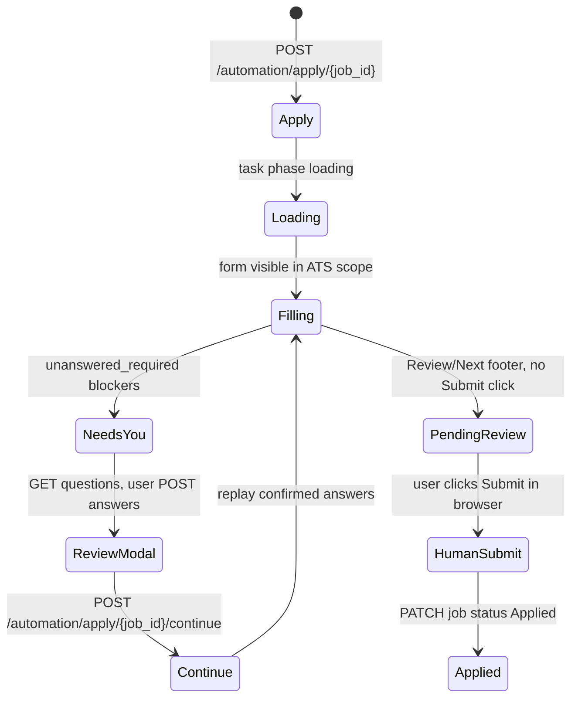

# Agent handoff guide (ModGent)

This document is for **you** (another AI or developer) picking up work on ModGent without reading the entire chat history.

## Non-negotiable product rules

1. **Never auto-submit applications.** Do not click Submit, “Apply Now” on the final step, or equivalent. The human submits in the browser and marks Applied in the UI.
2. **Do not build captcha/stealth bypass.** `src/Agent/human_check.py` may click a visible Cloudflare/Turnstile checkbox inside challenge iframes only.
3. **Do not commit secrets or personal data.** `.gitignore` excludes `jobs.db`, `browser_profile/`, `data/`, `.env`, `*.pdf`, `*.docx`. Do not paste tokens or the user’s email/phone into docs or commits.
4. **Cover letters are not learned answers.** `POST .../answers` must not call `remember_answer` for question “cover letter”.
5. **Two browser profiles must stay separate.** Apply uses `browser_profile/app_session`; discovery uses `browser_profile/search_session`. Playwright `launch_persistent_context` cannot share one folder between two running browsers.

## Quick start commands

```bash
# Backend (repo root)
uvicorn src.api.main:app --host 127.0.0.1 --port 8000

# Frontend
cd frontend && npm install && npm run dev

# Ollama (required for good cover letters / AI answers)
ollama serve
# Model expected: llama3.2 (see ai_generator.py)
```

After **Python** edits, restart uvicorn manually. Frontend hot-reloads via Vite.

## End-to-end apply state machine



**Task outcomes** (`src/api/main.py` `_OUTCOMES`): `needs_you`, `review`, `stopped`, `closed`. While the page loads, task `result` is `"Waiting for the application page to finish loading."` and `progress` is `{"phase":"loading"}` so the Activity panel stays **running**, not completed.

**Live session registry** (`src/Agent/session_registry.py`): Maps `job_id` → Playwright context/page. Required for Continue and for posting reviewed answers onto the same tab.

## API surface (implementations in `src/api/main.py`)

| Method | Path | Purpose |
|--------|------|---------|
| GET | `/jobs`, `/jobs/{id}` | List / get jobs |
| PATCH | `/jobs/{id}?status=` | Update status; `Applied` harvests + closes session |
| GET/PUT | `/profile` | Candidate settings |
| POST | `/profile/cv` | PDF upload → `data/cv/cv_{uuid}.pdf`, filename on profile |
| POST | `/automation/discovery` | Background scrape + score + save |
| GET | `/automation/tasks/{task_id}` | Poll discovery/apply task |
| POST | `/automation/apply/{job_id}` | Start apply (headed Edge) |
| POST | `/automation/apply/{job_id}/continue` | Resume open session |
| GET | `/automation/apply/{job_id}/questions` | Blockers for review modal |
| POST | `/automation/apply/{job_id}/answers` | Save reviewed answers, type onto page |
| POST | `/automation/apply/{job_id}/close` | Close browser session |
| GET/DELETE | `/learned-answers` | Reusable answers (not cover letter) |

Profile and paths: `src/api/config.py` (`Settings`, `BASE_DIR` relative paths).

Database bootstrap: `init_db()` on startup; `_migrate_add_missing_columns()` adds `tasks.job_id`, `tasks.progress`, `answers.choices`, `answers.kind` on existing SQLite files.

## Where the hard problems live

| Problem | Primary files |
|---------|----------------|
| ATS iframe / Greenhouse embed | `form_filler.application_scope`, `focus_application`, `application_runner.open_application_form` |
| Indeed third-party redirect | `wait_for_company_page`, external Apply link clicks |
| React-select dropdowns | `_open_and_read_options` (aria-controls listbox only), `_is_dial_code_list`, `_attach_dropdown_options` |
| Checkbox “select all that apply” | `kind=checkbox`, legend as question, newline-separated draft |
| Cover letter PDF + review | `draft_cover_letter`, `stage_cover_letter`, `_letter_is_dump`, `prepare_application_documents` |
| CV display name on upload | Playwright `FilePayload` with `profile.cv_filename` |
| Hidden empty `[role=dialog]` stealing footer search | `_dialog_scope`, visible-only dialog filter in `application_runner` |
| Footer Next / Review / Submit | `_footer_button`; Submit detected but **not** clicked |

## Frontend integration

- `frontend/src/hooks/useAgent.ts` — discovery, apply, continue, review submit, task polling.
- `frontend/src/components/ui/DiffReviewModal.tsx` — draft panel, chips vs `<select>`, cover letter first.
- `frontend/src/utils/api.ts` — `API_BASE_URL = http://127.0.0.1:8000`.

## Discovery pipeline

`run_discovery_task` in `main.py`: `search_all_boards` → `group_by_posting` → `score_job` → `filter_jobs_by_score` → `save_job`. Requires CV + target roles on profile.

## Tests and legacy

- **`tests/`** — Not present in the public repo; do not assume pytest coverage exists.
- **`src/Lesson/`** — Tutorial scripts; ignore for product behavior.
- **`src/Agent/test_*.py`** — Manual Playwright experiments; not CI.
- Root **`main.py`** — Placeholder print only.
- **`CLAUDE.md`** previously referenced `src/Agent/main.py` and `database.py` — those paths are **obsolete**; use `src/api/models.py` and the API.

## Safe change checklist

- [ ] Submit still never clicked in `application_runner.py` / `form_filler.py`
- [ ] Apply task stays in loading phase until document + form ready
- [ ] Dropdown choices scoped per question key, not global `[role=option]`
- [ ] Restart uvicorn and verify one apply path (Greenhouse embed + review modal)
- [ ] No new tracked files under `browser_profile/`, `data/`, or `jobs.db`

## Recent engineering context (for regression awareness)

- Activity panel used to show “completed” while still on Indeed interstitial — fixed with load waits and loading phase.
- Cover letter used to paste CV header when Ollama failed — stricter prompt + dump detection + Ollama should be running.
- All dropdowns showed phone-country codes — fixed by listbox scoping and dial-code rejection.

## Repo hygiene

GitHub: **modgent**, account **ChallymodGet**, single clean commit history (old history with `browser_profile/` and `jobs.db` was removed locally before first push). Do not force-push `main` without explicit user request.
