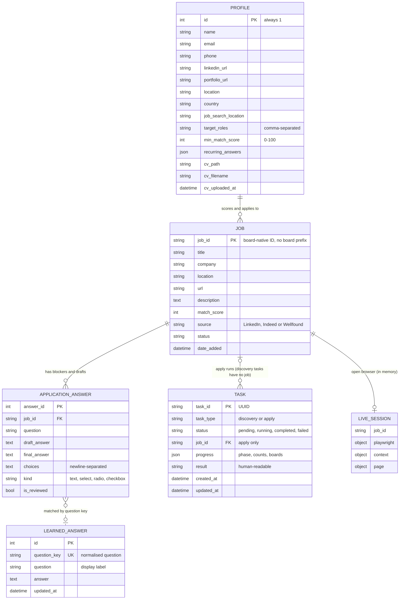
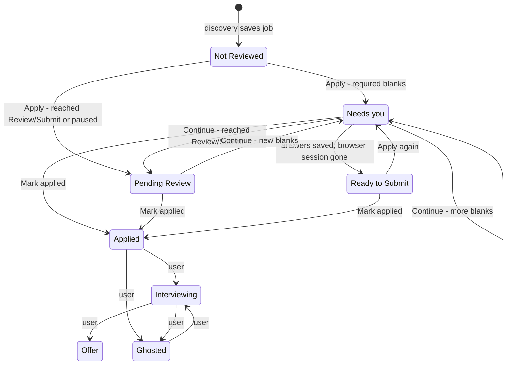
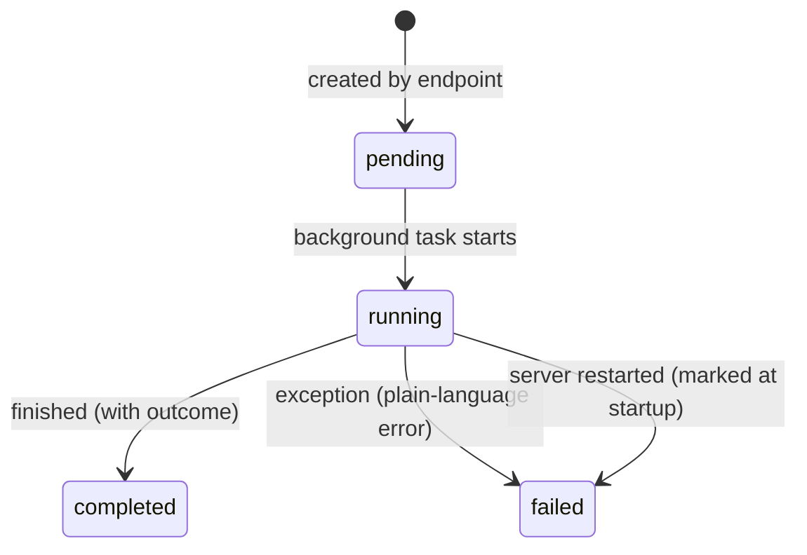
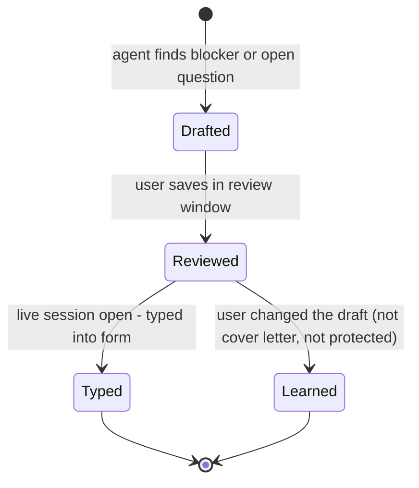

# ModGent — Domain Model

| | |
|---|---|
| **Scope** | Entities, relationships, lifecycles and rules of the job-search domain as implemented in Nov 2026, including the `fix/prd-gaps` changes |
| **Source of truth** | `src/api/models.py` (persistence), `src/api/main.py` (lifecycle), `src/Agent/` (domain services) |
| **Related** | [Product definition](./product-definition.md) · [PRD](./prd.md) |

## 1. Bounded contexts

| Context | Responsibility | Main code |
|---|---|---|
| **Candidate** | Who is applying: contact details, preferences, CV, standard answers | `Profile`, `parse_cv.py` |
| **Discovery** | Finding, de-duplicating and scoring listings | `scraper.py`, `pipeline.py`, `job_scorer.py` |
| **Application** | Filling one employer form, pausing for the user, never submitting | `application_runner.py`, `form_filler.py`, `session_registry.py` |
| **Knowledge** | Answers that carry over between applications | `LearnedAnswer`, `form_filler.remember_answer` |
| **Orchestration** | Long-running work and its progress | `Task`, background tasks in `main.py` |

## 2. Entity-relationship diagram

`LIVE_SESSION` is not persisted; it lives in `session_registry` in the API process. The dotted line between `APPLICATION_ANSWER` and `LEARNED_ANSWER` is a lookup by normalised question text, not a foreign key.

## 3. Entities

### 3.1 Profile (aggregate root, singleton)

The candidate. Exactly one row (`id = 1`), created from configuration seeds on first access.

- **Recurring answers** (value object, stored as JSON): `work_authorization`, `sponsorship_required`, `how_heard`, `non_compete`, `willing_to_relocate`, `years_experience`, `salary_expectation`.
- **Contact** (value object, derived): name, email, phone, LinkedIn, portfolio, location, country, used for form filling.
- **Core skills** and **candidate summary** (derived, not stored): extracted from the CV text on each run.
- `has_cv` is true only when `cv_path` is set **and** the file exists on disk.

### 3.2 Job (aggregate root)

A listing that passed the match threshold. Identity is the board's own job ID: LinkedIn's numeric ID, Indeed's `jk` key, or Wellfound's ID (falling back to the listing path).

- Created only by discovery, only if no job with that ID exists (rescans never reset status).
- `match_score` is fixed at save time; a later CV change does not rescore existing jobs.
- Owns its `ApplicationAnswer`s and is referenced by apply `Task`s.

### 3.3 ApplicationAnswer (entity within Job)

One question on one job's form that needs the user: an unanswered required field, an AI draft for an open-ended question, a missing résumé choice, or a cover letter.

- `draft_answer`: what the agent proposes (may be empty).
- `final_answer`: what the user approved; set together with `is_reviewed = true`.
- `choices` + `kind`: the site's own options, so the review UI offers exactly what the form accepts.
- Unique per (job, question) by question match, upserted on each pass.

### 3.4 LearnedAnswer (entity, Knowledge context)

An answer the user gave once, reused anywhere the same question appears.

- `question_key` = lower-cased, whitespace-collapsed question, max 400 chars. Unique.
- Looked up by exact key first, then by containment when both sides are at least 12 characters.

### 3.5 Task (entity, Orchestration context)

One background run. `discovery` tasks have no job; `apply` tasks (including Continue) reference a job. `progress` carries the machine-readable phase; `result` carries the sentence shown to the user.

## 4. Lifecycles

### 4.1 Job status

| Status | Set by | Meaning | Side effects |
|---|---|---|---|
| Not Reviewed | Discovery | Qualifies on score; untouched | — |
| Needs you | Apply runner | Paused on blockers the user must answer | Blockers stored; review window opens |
| Pending Review | Apply runner | Filled as far as possible; stopped before Submit | — |
| Ready to Submit | Answer submission | Answers saved but browser session was gone | — |
| Applied | User | User submitted in the browser | Harvest typed fields → learned answers; close session |
| Interviewing / Offer | User (job card actions) | Post-application progress | — |
| Ghosted | User (job card actions) | No response | Close session |

> The API rejects unknown status values (PRD T-4). It does not enforce which transitions are allowed; the job card only offers the ones in the diagram.

### 4.2 Task status and outcome

Apply tasks record an **outcome** in `progress.phase` when completed:

| Outcome | Meaning | User's next action |
|---|---|---|
| `needs_you` | Required fields need the user | Answer in the review window, then Continue |
| `review` | Reached Review/Submit | Check the form, Submit in the browser, Mark applied |
| `stopped` | No Next/Review control found | Fill remaining blanks in the browser, then Continue |
| *(reopened)* | Not a separate outcome: if the user closed the window, Apply/Continue reopens the form and `progress.reopened` is true; the result starts with "The application window was closed, so it was opened again." | Follow the outcome shown after the note |

While a page is loading, a running apply task has `progress.phase = "loading"`. Discovery phases are `preparing`, then `opening → reading → done` (or `failed`) for each board in parallel, then `scoring`.

### 4.3 Answer lifecycle

Separately, any field the user typed directly in the browser is **harvested** into a `LearnedAnswer` when they click Continue or Mark applied.

## 5. Domain services

| Service | Input → Output | Rules |
|---|---|---|
| **Skill extraction** (`build_skills_from_cv`) | CV PDF → ranked core skills (top 15) | Ranked by frequency in the CV; grouped skills keep their members |
| **Deduplication** (`group_by_posting`) | Listings → groups keyed by (company, title, description) | First posting of each group is kept |
| **Scoring** (`score_job`) | Listing + target roles + core skills → 0–100 | Whole-word matching. Title 30, skill coverage 30, core strength 25 (matches weighted by CV rank), role relevance 15 (see PRD §5.3) |
| **Threshold filter** (`filter_jobs_by_score`) | Scored listings + minimum → qualifying listings | Inclusive (`score >= minimum`) |
| **Field resolution** (`desired_field_value`) | Field label + contact + recurring + learned → value or nothing | Protected → nothing; then contact; then recurring; then learned |
| **Question matching** (`questions_match`) | Two labels → same question? | Normalised equality, or containment when both ≥ 12 chars |
| **Answer learning** (`remember_answer`) | Question + answer → stored/updated | Skips blanks, protected questions and keys under 3 chars |
| **Answer drafting** (`generate_application_answer`) | Question + job + CV summary → draft | Local Ollama `llama3.2`; returns nothing if the model is down |
| **Cover letter** (`stage_cover_letter`) | Job + CV text → PDF + blocker for approval | Contact lines stripped from CV input; output rejected if it looks like a CV dump |
| **Apply runner** (`advance_application`) | Live page + job + candidate → outcome | Up to 8 steps; stops before Submit; see §4.1 |

## 6. Invariants

These must hold after any change. Unit tests or code review should check each.

1. **No agent submission.** The apply runner never clicks a Submit-type control. A job reaches `Applied` only through a user action.
2. **Protected questions are never answered or learned.** Labels containing race, ethnicity, gender, sexual orientation, disability, veteran, pronoun, demographic, self-identification, national origin or "voluntary" are skipped.
3. **Cover letters are never learned answers.**
4. **One profile.** The `profile` table has at most one row, `id = 1`.
5. **Rescans don't reset progress.** Discovery never overwrites an existing job.
6. **One browser per profile directory.** Apply uses `app_session`; discovery uses one profile per board (`search_linkedin`, `search_session` for Indeed, `search_wellfound`) so boards run in parallel; only one live apply session per job.
7. **Learned answers are unique by question key.**
8. **Only user-changed answers are learned.** An untouched AI draft stays a one-off for its job.

## 7. Known modelling gaps

| Gap | Consequence | PRD ref |
|---|---|---|
| Job ID has no board namespace | Cross-board ID collision drops a job | D-8 |
| Live sessions are in memory only | API restart loses the open application | N-6 |
| Score not recomputed on CV change | Old jobs keep stale scores | S-4 |
| Keyword substring rules in field matching | Wrong values in some fields ("statement", "experience") | A-14 |

## 8. Glossary

| Term | Definition |
|---|---|
| **ATS** | Applicant tracking system hosting the employer's form (Greenhouse, Lever, etc.) |
| **Blocker** | A required field the agent could not fill; stored as an `ApplicationAnswer` |
| **Board** | A job listing site searched by discovery: LinkedIn, Indeed, Wellfound |
| **Core skills** | Top skills extracted from the CV, used for scoring |
| **Harvest** | Reading values the user typed into the live form and saving them as learned answers |
| **Live session** | The open Playwright browser for a job, kept between Apply, review and Continue |
| **Outcome** | How an apply task ended: `needs_you`, `review`, `stopped` (with a "reopened" note when the window had been closed) |
| **Question key** | Normalised question text used to match the same question across forms |
| **Recurring answers** | Profile-level answers to standard logistics questions |
| **Replay** | Typing already-confirmed answers into the form when resuming with Continue |
